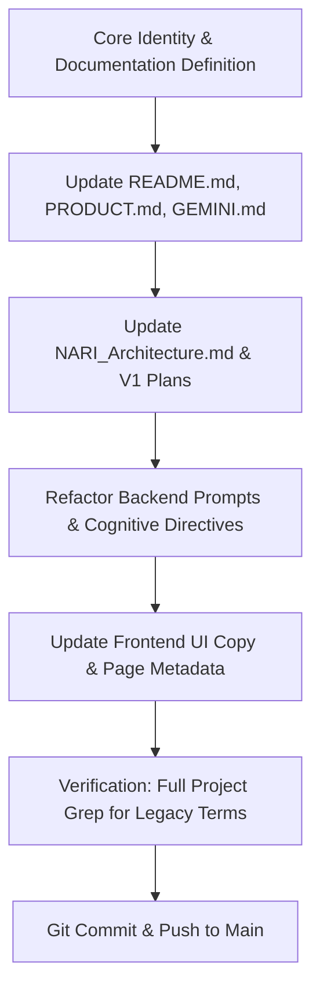

# Plan: NARI AGI Repositioning & Architectural Reframing

## 1. Goal Description

Pivot NARI's identity, terminology, documentation, and interface phrasing away from "self-hosted personal operating system" or generic "productivity tool". Reposition NARI as a **Sovereign Personal AGI in its foundational evolutionary stages** — a continuous, highly perceptive, autonomous personal intelligence that unifies cognitive memory, environmental telemetry, spatial awareness, and active execution for a single user.

> [!IMPORTANT]
> In accordance with user directives:
> - Eliminate all descriptions of NARI as a "self-hosted OS", "personal OS", or "productivity app".
> - Embody the calm, ever-present, hyper-capable command intelligence persona without referencing pop-culture names (e.g., no mentions of Jarvis, Friday, or Iron Man).
> - Present the current system as the **foundational cognitive architecture (Early-Stage Sovereign AGI)** upon which continuous memory, deep reflection, and autonomous reasoning are evolving.

---

## 2. Terminology & Conceptual Lexicon Shift

| Old Framing | New AGI Framing | Architectural Meaning |
| :--- | :--- | :--- |
| "Self-hosted personal operating system" | **"Sovereign Personal AGI (Foundational Architecture)"** | An autonomous cognitive intelligence residing entirely on private infrastructure under absolute user sovereignty. |
| "Productivity platform / tool" | **"Cognitive Execution & Memory Fabric"** | The operational substrate through which the AGI tracks tasks, focus, knowledge, and life directives. |
| "AI-ready but AI-deferred" | **"Cognitive Grounding from Day Zero"** | The AGI grounds its reasoning in real historical activity logs and behavioral telemetry rather than hollow prompt illusions. |
| "Web dashboard / UI" | **"The Bridge / Neural Interface"** | The primary interaction locus where user intent and AGI awareness converge. |
| "Stage 9 AI Co-pilot" | **"Core Cognitive Engine & Executive Agent"** | The central reasoning model capable of intent parsing, tool synthesis, and continuous memory integration. |

---

## 3. Scope of Proposed Modifications

### 3.1 Project Documentation
1. **[README.md](file:///H:/NARI/README.md)**:
   - Rewrite the hero header and overview: Replace "local-first, self-hosted personal productivity platform designed to act as a private personal operating system" with "NARI is a Sovereign Personal AGI in its foundational architecture — an autonomous, continuous cognitive intelligence designed to perceive, remember, reflect, and execute alongside you."
   - Reframe key features as cognitive subsystems (Cognitive Memory, Spatial Telemetry, Atmospheric Awareness, Executive Action Core).

2. **[PRODUCT.md](file:///H:/NARI/PRODUCT.md)**:
   - Update Product Purpose to define NARI as a nascent private AGI command intelligence.
   - Refine design principles from "hardware honesty / utility first" to "Autonomous Presence, Absolute Sovereignty, and High Data Density".

3. **[GEMINI.md](file:///H:/NARI/GEMINI.md)**:
   - Update Project Overview to reflect the Sovereign AGI identity so coding assistants consistently preserve this framing across future work.

4. **[docs/NARI_Architecture.md](file:///H:/NARI/docs/NARI_Architecture.md)**:
   - Update Section 1 (Overview) and Section 2 (Design Principles) to present the system architecture as a cognitive intelligence pipeline:
     - Event & Perception Layer (Perception)
     - Cognitive Memory & Semantic Vector Store (Memory)
     - Executive Tool Engine (Action)
     - Reflection & Consolidation Engine (Meta-cognition)
     - The Bridge (Interface)

5. **[docs/plans/NARI_V1_VISION.md](file:///H:/NARI/docs/plans/NARI_V1_VISION.md)** & **[docs/plans/NARI_V1_ARCHITECTURE.md](file:///H:/NARI/docs/plans/NARI_V1_ARCHITECTURE.md)**:
   - Align the vision text: Reinforce "presence before interface", "an intelligence that is already awake", and the transition into a versioned, narrative-driven AGI mind.

6. **[docs/report/audit_and_modification_plan.md](file:///H:/NARI/docs/report/audit_and_modification_plan.md)**:
   - Update overview summaries to reflect the AGI positioning.

---

### 3.2 System Prompts & Cognitive Behavior
1. **[backend/app/ai/llm_client.py](file:///H:/NARI/backend/app/ai/llm_client.py)**:
   - Refine system prompt directives (`system_prompt`):
     - Replace "manage all domains of their personal productivity" with "act as Sir's Sovereign Personal AGI across all domains of life, research, strategy, and execution."
     - Maintain the warm, precise, loyal, highly capable executive tone.

2. **[backend/app/services/context_service.py](file:///H:/NARI/backend/app/services/context_service.py)**:
   - Update digestion prompt: Frame digestion as "NARI's autonomous background cognitive parser extracting long-term mental models, rules, and core beliefs."

---

### 3.3 UI & Presentation Layer Copy
1. **[frontend/src/pages/LoginPage.jsx](file:///H:/NARI/frontend/src/pages/LoginPage.jsx)**:
   - Replace generic button "Unlock NARI" and subtitle "Access Intelligence" with "Initialize Cognitive Link" / "Sovereign AGI Interface".
2. **[frontend/index.html](file:///H:/NARI/frontend/index.html)**:
   - Update `<title>` and metadata descriptions to "NARI | Sovereign Personal AGI".
3. **[frontend/src/components/layout/AssistantDrawer.jsx](file:///H:/NARI/frontend/src/components/layout/AssistantDrawer.jsx)**:
   - Refresh boot copy: `SYSTEM BOOT: NARI Cognitive Core online. Subsystems synchronized. Standing by for directives.`

---

## 4. Execution Sequence



1. **Phase 1: Foundation Docs** — `README.md`, `PRODUCT.md`, `GEMINI.md`, `docs/NARI_Architecture.md`.
2. **Phase 2: Vision & Plans** — `docs/plans/NARI_V1_*.md`, `docs/report/audit_and_modification_plan.md`.
3. **Phase 3: Cognitive Prompts** — `backend/app/ai/llm_client.py`, `context_service.py`.
4. **Phase 4: Client Shell Copy** — `frontend/index.html`, `LoginPage.jsx`, `AssistantDrawer.jsx`.
5. **Phase 5: Purity Verification** — Automated case-insensitive scan across the entire repository to ensure zero occurrences of `"personal operating system"`, `"productivity tool"`, or forbidden pop-culture references remain.

---

## 5. Verification Plan

### Automated Checks
- Grep repository for banned terms:
  ```powershell
  Select-String -Path README.md, PRODUCT.md, GEMINI.md, docs\**\*.md -Pattern "personal operating system", "productivity platform", "productivity app", "Jarvis", "Friday", "Iron Man"
  ```
  Expected: **0 matches**.

### Cognitive & Conversational Verification
- Run test query against the AI co-pilot endpoint (`/api/v1/ai/chat`) with `"Who are you?"` and verify NARI identifies itself as your sovereign personal intelligence, operating with high-fidelity executive competence.
